# Versand — Konzept

Stand 0.0.1 (2026-11-20). Beschlüsse: **D-1496** (Modul, Filter, Kauf nur auf Klick), **D-1497** (Modellknoten «Sendungen», PROPOSED, Stefans Karte).

## Ablauf

```mermaid
flowchart LR
  P["Sendung: Gewicht, Maße, Land"] --> R["taxmod_shipping_rates"]
  R --> T["Tarife, günstigster zuerst"]
  T -->|Klick «Kaufen», Preis wie gezeigt| B["taxmod_shipping_buy"]
  B --> W["wartet auf Bezahlung (Seite des Dienstes)"]
  W -->|Klick «Stand abfragen»| S["taxmod_shipping_status"]
  S --> E["bezahlt, Sendungsnummer"]
  E -->|Klick «Drucken» / «PDF»| L["taxmod_shipping_label"]
```



Das Modul kennt keinen Dienst. Jeder Dienst-Anschluss (z. B. `wp_tax_api_dhl`) beantwortet die vier Filter für sich.
Geld fließt nur auf «Kaufen» mit dem gezeigten Preis; hat sich der Preis geändert, wird nichts gekauft. Gedruckt wird nur auf «Drucken».
Zugangsdaten bleiben im Reiter des Dienstes, nie hier.

## Filter

```php
// CONTRACT
apply_filters('taxmod_shipping_rates', [], ['weight_g' => int, 'length_cm' => int, 'width_cm' => int, 'height_cm' => int, 'country' => 'DE']);
// → list<['carrier', 'product', 'name', 'price_cents', 'tracked', 'liability_eur'] | ['carrier', 'error']>
apply_filters('taxmod_shipping_buy', null, $rate, ['sender' => $address, 'receiver' => $address, 'email' => string]);
// $address = ['name', 'street', 'number', 'postal_code', 'city', 'country', 'email', 'addition']
// → ['carrier', 'reference', 'state' => 'awaiting_payment'|'paid', 'pay_url', 'price_cents', 'numbers'?] | ['carrier', 'error'] | null
apply_filters('taxmod_shipping_status', null, ['carrier' => string, 'reference' => string]);
// → ['state', 'numbers', 'pay_url'] | ['error'] | null
apply_filters('taxmod_shipping_label', null, $carrier, $number); // → PDF-Bytes | WP_Error | null
```

Ein Dienst antwortet nur, wenn `carrier` seiner ist, und gibt sonst die Antwort davor unverändert zurück.

## Annahmen (nicht im Beschluss)

- ⚠️ *INFERRED:* Bis «Sendungen» im Modell steht (D-1497), liegen die Käufe in der Option `taxmod_shipping_purchases` (die letzten 200). Danach wird jeder Kauf ein Satz und die Option einmal übernommen und gelöscht.
- Absender ist ein Kontakt-Satz (D-1497). Seine Adresse wird über die vorhandenen Kompositionen gelesen: Kontakt › «Address» › «Street / H#», «Zip/City», «Country» (D-1250). Die Felder werden über Rollen benannt (D-1394), höchstens drei Lesevorgänge. In der Option `taxmod_shipping_settings` stehen nur die Kontakt-Nummer, die Bestätigungs-Mail und die Druckerwarteschlange.
- ⚠️ *INFERRED:* «Country» ist Freitext. Gängige Namen werden auf ISO-Kürzel abgebildet, ein unbekannter Name geht unverändert an den Dienst.
- E-Mail am Kontakt gibt es im Modell nicht; sie kommt als Nachtrag zur Karte D-1497.
- ⚠️ *INFERRED:* Empfänger wird im Kauf-Dialog getippt; später Verweis auf Kontakte (D-1497).
- Preislisten für Dienste ohne Privat-API (GLS, Hermes, DPD) kommen als Daten ins Modell, nicht in den Code (D-1496), noch nicht gebaut.
- Sammeldienste (Packlink PRO, Sendcloud, Shipcloud): später, Stefan entscheidet.
- Briefe über Internetmarke (Portokasse): noch nicht gebaut.
