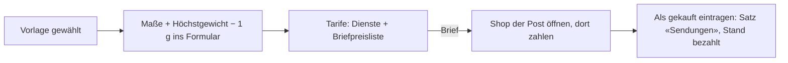
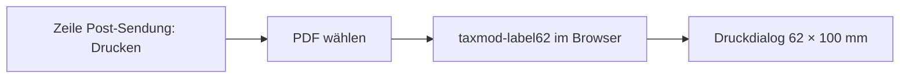

# Versand — Konzept

Stand 0.0.1 (2026-11-20). Beschlüsse: **D-1496** (Modul, Filter, Kauf nur auf Klick), **D-1497** (Modellknoten «Sendungen» und «E-Mail» am Kontakt, ACCEPTED: Stefans Karte 20.11.2026 06:36 UTC).

## Ablauf

```mermaid
flowchart LR
  P["Sendung: Gewicht, Maße, Land"] --> R["taxmod_shipping_rates"]
  R --> T["Tarife, günstigster zuerst"]
  T -->|Klick «Kaufen», Preis wie gezeigt| B["taxmod_shipping_buy"]
  B --> W["wartet auf Bezahlung (Seite des Dienstes)"]
  W -->|Klick «Stand abfragen»| S["taxmod_shipping_status"]
  S --> E["bezahlt, Sendungsnummer"]
  E -->|Klick «Drucken» / «PDF»| L["taxmod_shipping_label"]
```



Das Modul kennt keinen Dienst. Jeder Dienst-Anschluss (z. B. `wp_tax_api_dhl`) beantwortet die vier Filter für sich.
Geld fließt nur auf «Kaufen» mit dem gezeigten Preis; hat sich der Preis geändert, wird nichts gekauft. Gedruckt wird nur auf «Drucken».
Zugangsdaten bleiben im Reiter des Dienstes, nie hier.

## Filter

```php
// CONTRACT
apply_filters('taxmod_shipping_rates', [], ['weight_g' => int, 'length_cm' => int, 'width_cm' => int, 'height_cm' => int, 'country' => 'DE']);
// → list<['carrier', 'product', 'name', 'price_cents', 'tracked', 'liability_eur'] | ['carrier', 'error']>
apply_filters('taxmod_shipping_buy', null, $rate, ['sender' => $address, 'receiver' => $address, 'email' => string]);
// $address = ['name', 'street', 'number', 'postal_code', 'city', 'country', 'email', 'addition']
// → ['carrier', 'reference', 'state' => 'awaiting_payment'|'paid', 'pay_url', 'price_cents', 'numbers'?] | ['carrier', 'error'] | null
apply_filters('taxmod_shipping_status', null, ['carrier' => string, 'reference' => string]);
// → ['state', 'numbers', 'pay_url'] | ['error'] | null
apply_filters('taxmod_shipping_label', null, $carrier, $number); // → PDF-Bytes | WP_Error | null
```

Ein Dienst antwortet nur, wenn `carrier` seiner ist, und gibt sonst die Antwort davor unverändert zurück.

## Annahmen (nicht im Beschluss)

- Jeder Kauf ist ein Satz in «Sendungen» (D-1497, AR-1), geschrieben über `write-data` als ein Akt, also rückgängig machbar (D-1410). Preis, Gewicht und Maße sind Einheitenwerte (Betrag, Einheit, Vorsatz). Mehrere Sendungsnummern gehen als `{values: [...]}`.
- Absender ist ein Kontakt-Satz (D-1497). Seine Adresse wird über die vorhandenen Kompositionen gelesen: Kontakt › «Address» › «Street / H#», «Zip/City», «Country» (D-1250). Die Felder werden über Rollen benannt (D-1394), höchstens drei Lesevorgänge. In der Option `taxmod_shipping_settings` stehen nur die Kontakt-Nummer, die Bestätigungs-Mail und die Firmen der Dienste. Gedruckt wird auf dem Standarddrucker des Arbeitsplatzes (D-1502), den das Etikettenmodul über `taxmod_label_catalog` nennt; Versand hält keinen eigenen Drucker (Stefan 20.11. «passt nicht zu unserem Druckkonzept», ab 0.0.4).
- ⚠️ *INFERRED:* «Country» ist Freitext. Gängige Namen werden auf ISO-Kürzel abgebildet, ein unbekannter Name geht unverändert an den Dienst.
- «E-Mail» am Kontakt ist Teil von D-1497.
- Empfänger: vorhandener Kontakt aus der Liste, oder im Kauf-Dialog getippt. Ein getippter Empfänger wird im selben Akt als neuer Person-Kontakt mit Adresse angelegt (D-1497).
- ⚠️ *INFERRED:* Die Ids von Knoten, Feldern, Ständen und Einheiten kommen über Rollen (D-1394); die Live-Ids setzt WP-Upload beim Anlegen.
- Preislisten für Dienste ohne Privat-API (GLS, Hermes, DPD) kommen als Daten ins Modell, nicht in den Code (D-1496), noch nicht gebaut.
- Sammeldienste (Packlink PRO, Sendcloud, Shipcloud): später, Stefan entscheidet.
- Briefe über Internetmarke (Portokasse): noch nicht gebaut.

## Vorlagen und Briefe (0.0.3)

Beschlüsse: **D-1505** (Versandverpackungen als Materialgruppe unter Verbrauchsmaterial), **D-1506** (Briefprodukte als Preisliste, Kauf im Shop der Post). Beides auf Stefans Karte vom 20.11.2026, 09:01 und 09:02 UTC.



- Die Vorlage ist ein Material der Gruppe «Versandverpackungen» (Rolle `packaging`). Gewählt wird sie mit dem Satz-Wähler des Modellers (D-1182), in dem man gleich eine neue Vorlage anlegen kann. Es wird nur gelesen, und was der Besitzer danach tippt, gilt.
- Briefe sind Sätze in «Briefprodukte» (Rolle `letter_product`): Name, Produktnummer, Preis, Höchstmaße, Höchstgewicht und Shop. Ein Produkt ohne https-Shop oder ohne Preis wird nicht angeboten.
- Kauf: Bei uns fließt kein Geld. Stefan hat keine Portokasse, und die Internetmarke-API verkauft nur gegen Portokasse.
- ⚠️ *INFERRED:* Die Briefpreisliste gilt nur für das Zielland DE.
- ⚠️ *INFERRED:* Die Vorbelegung (Preise und Maße Stand 1.1.2025) muss Stefan prüfen. Die Produktnummern bleiben leer, bis sie belegt sind.

## Marke auf 62 mm drucken (0.0.4, D-1507)

Eine im Post-Shop gekaufte Internetmarke ist ein A4-PDF auf Stefans Rechner. In der Zeile einer Post-Sendung unter «Gekaufte Etiketten» öffnet der Druckknopf die Dateiwahl. Das Script `taxmod-label62` des Etikettenmoduls liest das PDF im Browser, schneidet Marke und Anschrift zu, dreht sie und öffnet den Druckdialog für das 62-mm-Band des QL-810W. Das PDF wird nicht hochgeladen und nicht gespeichert, und gedruckt wird nur auf Klick. Fehlt das Etikettenmodul, fehlt der Knopf.



INFERRED: Die Marke trägt keinen Zusatztext (eBay setzt dort Bestellnummer und Verkäufer). Gemessen mit der Marke vom 20.11.2026: 54 × 97 mm.
