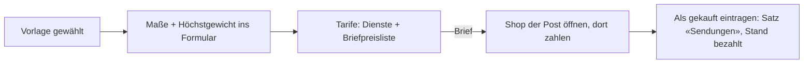
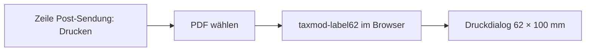
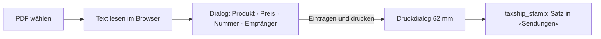
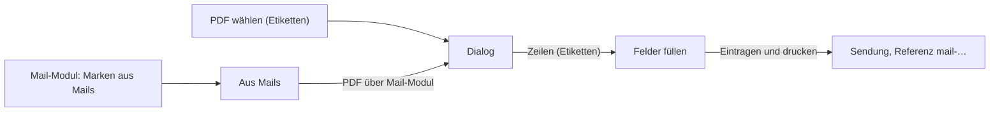
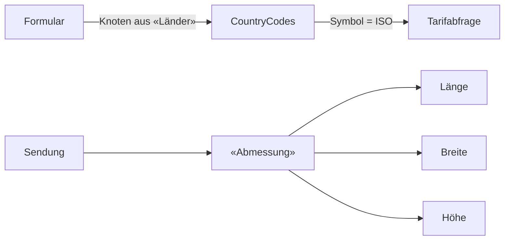

# Versand — Konzept

Stand 0.0.1 (2026-11-20). Beschlüsse: **D-1496** (Modul, Filter, Kauf nur auf Klick), **D-1497** (Modellknoten «Sendungen» und «E-Mail» am Kontakt, ACCEPTED: Stefans Karte 20.11.2026 06:36 UTC).

## Ablauf

```mermaid
flowchart LR
  P["Sendung: Gewicht, Maße, Land"] --> R["taxmod_shipping_rates"]
  R --> T["Tarife, günstigster zuerst"]
  T -->|Klick «Kaufen», Preis wie gezeigt| B["taxmod_shipping_buy"]
  B --> W["wartet auf Bezahlung (Seite des Dienstes)"]
  W -->|Klick «Stand abfragen»| S["taxmod_shipping_status"]
  S --> E["bezahlt, Sendungsnummer"]
  E -->|Klick «Drucken» / «PDF»| L["taxmod_shipping_label"]
```



Das Modul kennt keinen Dienst. Jeder Dienst-Anschluss (z. B. `wp_tax_api_dhl`) beantwortet die vier Filter für sich.
Geld fließt nur auf «Kaufen» mit dem gezeigten Preis; hat sich der Preis geändert, wird nichts gekauft. Gedruckt wird nur auf «Drucken».
Zugangsdaten bleiben im Reiter des Dienstes, nie hier.

## Filter

```php
// CONTRACT
apply_filters('taxmod_shipping_rates', [], ['weight_g' => int, 'length_cm' => int, 'width_cm' => int, 'height_cm' => int, 'country' => 'DE']);
// → list<['carrier', 'product', 'name', 'price_cents', 'tracked', 'liability_eur'] | ['carrier', 'error']>
apply_filters('taxmod_shipping_buy', null, $rate, ['sender' => $address, 'receiver' => $address, 'email' => string]);
// $address = ['name', 'street', 'number', 'postal_code', 'city', 'country', 'email', 'addition']
// → ['carrier', 'reference', 'state' => 'awaiting_payment'|'paid', 'pay_url', 'price_cents', 'numbers'?] | ['carrier', 'error'] | null
apply_filters('taxmod_shipping_status', null, ['carrier' => string, 'reference' => string]);
// → ['state', 'numbers', 'pay_url'] | ['error'] | null
apply_filters('taxmod_shipping_label', null, $carrier, $number); // → PDF-Bytes | WP_Error | null
```

Ein Dienst antwortet nur, wenn `carrier` seiner ist, und gibt sonst die Antwort davor unverändert zurück.

## Annahmen (nicht im Beschluss)

- Jeder Kauf ist ein Satz in «Sendungen» (D-1497, AR-1), geschrieben über `write-data` als ein Akt, also rückgängig machbar (D-1410). Preis, Gewicht und Maße sind Einheitenwerte (Betrag, Einheit, Vorsatz). Mehrere Sendungsnummern gehen als `{values: [...]}`.
- Absender ist ein Kontakt-Satz (D-1497). Seine Adresse wird über die vorhandenen Kompositionen gelesen: Kontakt › «Address» › «Street / H#», «Zip/City», «Country» (D-1250). Die Felder werden über Rollen benannt (D-1394), höchstens drei Lesevorgänge. In der Option `taxmod_shipping_settings` stehen nur die Kontakt-Nummer, die Bestätigungs-Mail und die Firmen der Dienste. Gedruckt wird auf dem Standarddrucker des Arbeitsplatzes (D-1502), den das Etikettenmodul über `taxmod_label_catalog` nennt; Versand hält keinen eigenen Drucker (Stefan 20.11. «passt nicht zu unserem Druckkonzept», ab 0.0.4).
- ⚠️ *INFERRED:* «Country» ist Freitext. Gängige Namen werden auf ISO-Kürzel abgebildet, ein unbekannter Name geht unverändert an den Dienst.
- «E-Mail» am Kontakt ist Teil von D-1497.
- Empfänger: vorhandener Kontakt aus der Liste, oder im Kauf-Dialog getippt. Ein getippter Empfänger wird im selben Akt als neuer Person-Kontakt mit Adresse angelegt (D-1497).
- ⚠️ *INFERRED:* Die Ids von Knoten, Feldern, Ständen und Einheiten kommen über Rollen (D-1394); die Live-Ids setzt WP-Upload beim Anlegen.
- Preislisten für Dienste ohne Privat-API (GLS, Hermes, DPD) kommen als Daten ins Modell, nicht in den Code (D-1496), noch nicht gebaut.
- Sammeldienste (Packlink PRO, Sendcloud, Shipcloud): später, Stefan entscheidet.
- Briefe über Internetmarke (Portokasse): noch nicht gebaut.

## Vorlagen und Briefe (0.0.3)

Beschlüsse: **D-1505** (Versandverpackungen als Materialgruppe unter Verbrauchsmaterial), **D-1506** (Briefprodukte als Preisliste, Kauf im Shop der Post). Beides auf Stefans Karte vom 20.11.2026, 09:01 und 09:02 UTC.



- Die Vorlage ist ein Material der Gruppe «Versandverpackungen» (Rolle `packaging`). Gewählt wird sie mit dem Satz-Wähler des Modellers (D-1182), in dem man gleich eine neue Vorlage anlegen kann. Es wird nur gelesen, und was der Besitzer danach tippt, gilt. Die Felder füllen sich sofort bei der Wahl (Skript `parcel-template.js`); ohne Skript beim nächsten «Tarife vergleichen».
- Briefe sind Sätze in «Briefprodukte» (Rolle `letter_product`): Name, Produktnummer, Preis, Höchstmaße, Höchstgewicht und Shop. Ein Produkt ohne https-Shop oder ohne Preis wird nicht angeboten.
- Kauf: Bei uns fließt kein Geld. Stefan hat keine Portokasse, und die Internetmarke-API verkauft nur gegen Portokasse.
- ⚠️ *INFERRED:* Die Briefpreisliste gilt nur für das Zielland DE.
- ⚠️ *INFERRED:* Die Vorbelegung (Preise und Maße Stand 1.1.2025) muss Stefan prüfen. Die Produktnummern bleiben leer, bis sie belegt sind.

## Marke auf 62 mm drucken (0.0.4, D-1507)

Eine im Post-Shop gekaufte Internetmarke ist ein A4-PDF auf Stefans Rechner. In der Zeile einer Post-Sendung unter «Gekaufte Etiketten» öffnet der Druckknopf die Dateiwahl. Das Script `taxmod-label62` des Etikettenmoduls liest das PDF im Browser, schneidet Marke und Anschrift zu, dreht sie und öffnet den Druckdialog für das 62-mm-Band des QL-810W. Das PDF wird nicht hochgeladen und nicht gespeichert, und gedruckt wird nur auf Klick. Fehlt das Etikettenmodul, fehlt der Knopf.



INFERRED: Die Marke trägt keinen Zusatztext (eBay setzt dort Bestellnummer und Verkäufer). Gemessen mit der Marke vom 20.11.2026: 54 × 97 mm.

## Gekaufte Marke hochladen (0.0.6, D-1507)

Stefan (20.11. 15:06): «kannst du nicht einfach gekaufte marke hochladen machen bei versand». Über «Gekaufte Etiketten» öffnet der Knopf «Gekaufte Marke hochladen» einen Dialog. «PDF wählen» liest die Internetmarke im Browser (pdf.js aus `taxmod-label62`) und füllt Produkt, Preis (mit €) und Sendungsnummer. Der Empfänger ist freiwillig: Wird ein Kontakt gewählt, ist er der Empfänger (D-1497), sonst bleibt der Empfänger der Sendung leer. Die Anschrift auf der Marke wird nur angezeigt und nie gespeichert, es wird auch kein Kontakt daraus angelegt. Stefan 20.11. 15:20: «ich möchte auch nicht alle empfänger speichern schon wegen datenschutz». «Eintragen und drucken» öffnet erst den 62-mm-Druckdialog, danach legt der Server den Satz in «Sendungen» an: Firma Post, bezahlt, ohne Gewicht und Maße.



INFERRED: Der Leser kennt das Layout der Internetmarke vom 20.11.2026 (Datum und Preis in einer Zeile, Nummer «A0 …», Empfängerblock darunter, letzte Zeile PLZ und Ort). Was er nicht findet, bleibt leer. Das Produkt ist das Briefprodukt mit gleichem Preis, sonst «Einschreiben», wenn die Marke es sagt; sonst leer.

## Marken aus Mails, ein PDF-Baustein (D-1511)

Stefan 20.11. 15:26: «gleiche Funktionalität», 15:27: «Upload brauchen wir dennoch». Wählen und Lesen eines Porto-PDF macht nur das Etikettenmodul (`taxmodLabel62.pick()`, `taxmodLabel62.lines()`). `stamp-upload.js` öffnet selbst kein PDF mehr; es füllt nur die Felder aus den Zeilen, die das Etikettenmodul liefert.

Neu ist der Abschnitt «Aus Mails». Er zeigt die Marken, die das Mail-Modul aus Mails gelesen hat (Filter `taxmail_shipping_labels`) und die noch keine Sendung haben. «Sendung anlegen und drucken» holt das PDF über das Mail-Modul (`taxmail_shipping_label_pdf`, nur gespeicherte Links) und öffnet damit denselben Dialog wie der Upload. Die Sendung bekommt die Referenz «mail-<Warenkorb>» und die Firma ihres Dienstes (DHL oder Post). Danach meldet Versand dem Mail-Modul den Druck (`taxmail_shipping_label_printed`), und die Marke verschwindet aus der Liste.



OFFEN: Ob die Post nach einem Kauf im Shop eine Mail mit der Marke schickt, ist nicht geprüft. Bis dahin kommen in «Aus Mails» nur DHL-Online-Frankierungen.

Vorlage (Stefan 20.11. 15:33, «das mit dem -1 ist albern nim doch die richtigen masse»): Die Vorlage füllt das echte Höchstgewicht, nicht mehr «− 1 g».

## Marke gespeichert (D-1513)

Stefan 20.11. 16:23: «Kannst du es dann nicht einfach speichern?» Nach «Eintragen und drucken» geht das PDF der Marke mit dem Formular mit (verstecktes Feld, base64). Versand legt es unter dem Schlüssel «taxship-<Sendung>» im Speicher des Etikettenmoduls ab (`taxmod_postage_put`) und meldet es gleich als gedruckt. Die Zeile der Sendung druckt die gespeicherte Marke dann ohne neues Wählen. 14 Tage nach dem Druck löscht das Etikettenmodul das PDF; danach wählt man es wieder von der Platte. Versand schreibt selbst keine Datei, und die Anschrift wird weiter nicht als Feld gespeichert.

## Eine Liste «Etiketten» (D-1515)

Stefan 20.11. 16:26: «Eigentlich könnten wir ja auch eine Liste draus machen … Und dann hat sie noch eine Eigenschaft aus Mail oder hochgeladen.» «Aus Mails» und «Gekaufte Etiketten» sind jetzt eine Liste «Etiketten». Die Versandseite zeigt die neuesten 5, «Alle n Etiketten» öffnet dieselbe Liste ohne Grenze, und der Produktname öffnet die Einzelansicht (Status, «← Alle Etiketten», Aktionen, Daten).

Die Herkunft hat kein eigenes Feld. `LabelOrigin` liest sie an genau einer Stelle aus der Referenz der Sendung: «mail-…» aus Mail, «upload-…» hochgeladen, «shop-…» im Shop gekauft, sonst beim Dienst gekauft. Eine offene Marke aus einer Mail steht mit Stand «offen (aus Mail)» in derselben Liste. Wird daraus eine Sendung, trägt diese die Referenz «mail-<Warenkorb>», und die offene Zeile fällt weg; so erscheint keine Marke doppelt (`LabelRowsTest`).

INFERRED: Marken, die vor D-1515 hochgeladen wurden, tragen noch «shop-…» und heißen deshalb «im Shop gekauft».

## Länder und Abmessung (D-1532)

Stefans Karte 20.11. 18:44: das Zielland «sollte man eine Auswahlliste machen … Die Länder sollten wir als Feld, als Konstantenliste anlegen», und für Länge, Breite, Höhe «das kombinierte Feld Abmessung. Das sollte eigentlich überall dafür verwendet werden. Zentimeter ist okay».



**Länder.** Eine Konstantenliste «Länder» unter Konstanten › Allgemein, je Land ein Knoten. Der Name ist je Sprache beschriftet (D-646), der ISO-Code steht in der Beschriftung «Symbol» (D-1534). Die Liste wird über die Rolle `nodes:countries` gefunden; das Formular wählt mit dem Knotenwähler des Modellers, und `CountryCodes` macht daraus den Code für die Dienste. Ohne die Rolle oder ohne Modeller ab 0.2.185 bleibt das alte Textfeld.

**Abmessung.** Sendungen und Versandverpackungen tragen ein Feld «Abmessung» (Ziel «Dimension»). Die Kanten liegen darin als Einheitswerte in Zentimeter, über die Rollen `dimension_length/width/height`, die auch das Lager benutzt. Rollen: `fields:shipment_dimension`, `fields:packaging_dimension`. Die Vorlagen werden in drei Lesevorgängen gelesen, gleich wie viele (CD-7).

INFERRED: Die Werte der 7 Vorlagen werden mit einem Datenjob in «Abmessung» kopiert; die alten Felder Länge/Breite/Höhe werden danach geparkt (`remove_field`, Werte bleiben), nicht gelöscht.
Offen: Gewicht und Abmessung im Vergleichsformular als Modeller-Eingaben, sobald der Baustein «in Basiseinheit» da ist (Prüftor).

## Länder nach Kontinenten (0.0.16, D-1537)

Stefan 20.11. 20:52: «die länderliste mal nach kontinenten ordnen also kontinent als übergeordnetes». Unter «Länder» stehen sieben Kontinente (Klasse Kategorie, Name englisch, Beschriftung je Sprache), darunter die Länder. Die Länder werden verschoben, nicht neu angelegt: ihre Knoten-Ids und Symbole bleiben. `Countries` liest den Baum zwei Ebenen tief, und `CountryCodes::groups` macht die Liste und jeden Knoten mit Kindern im Wähler unwählbar (`CountryCodesTest`).

INFERRED: Zuordnung nach UN M49 (Russland Europa; Türkiye, Zypern, Kaukasus Asien; Grönland, Mittelamerika, Karibik Nordamerika; Antarktis nur AQ).
